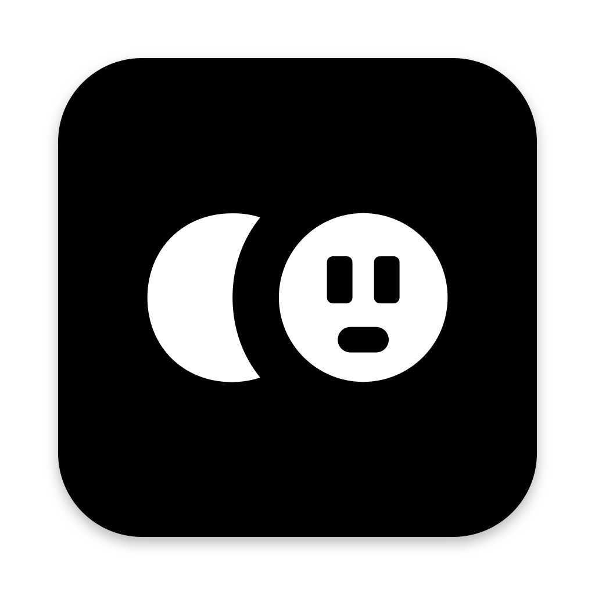
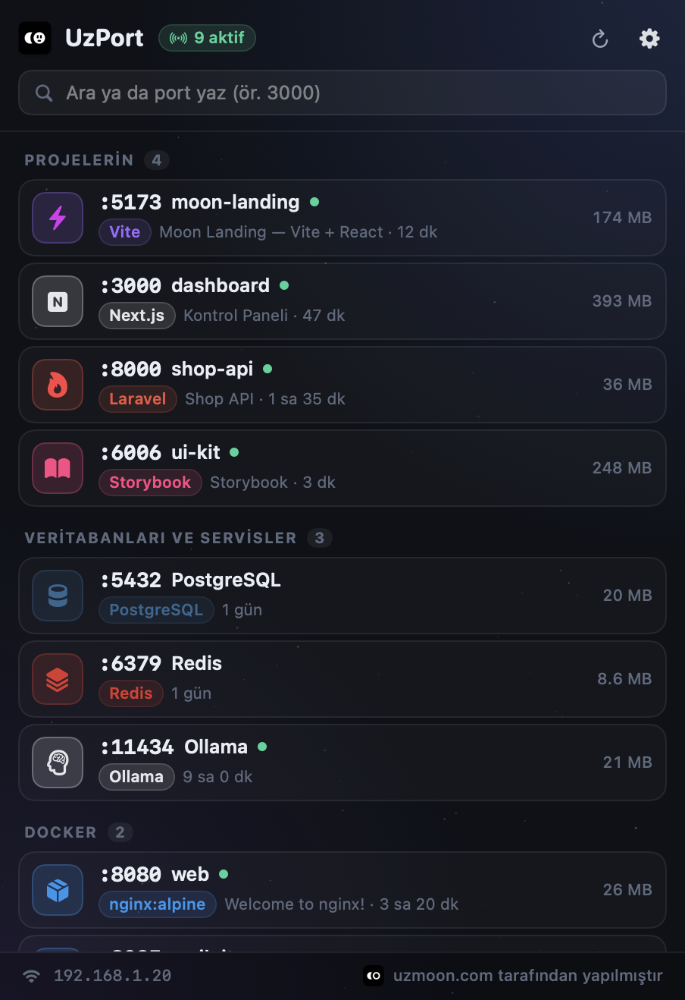
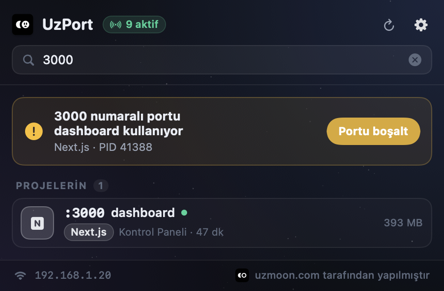
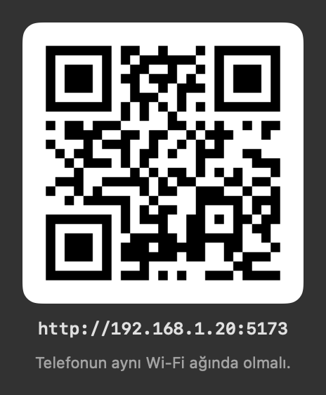
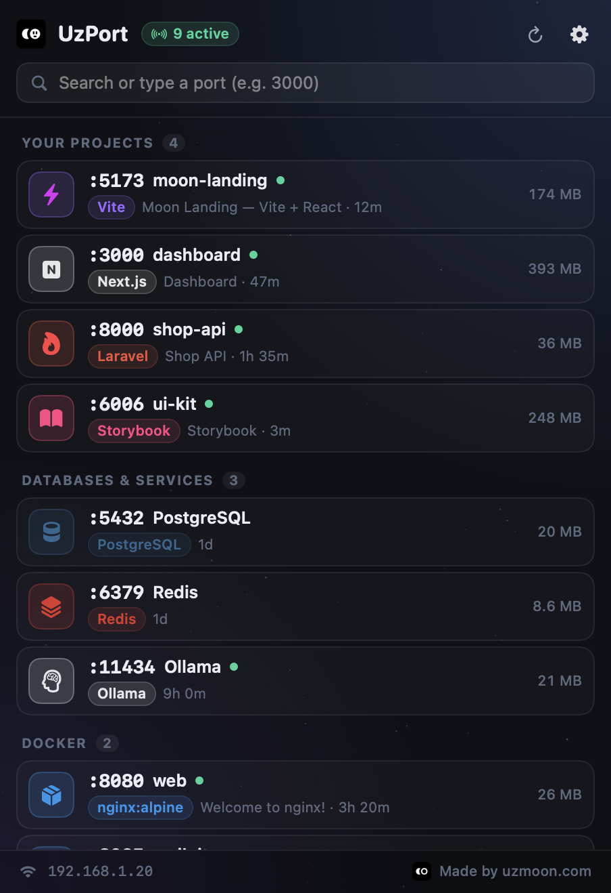
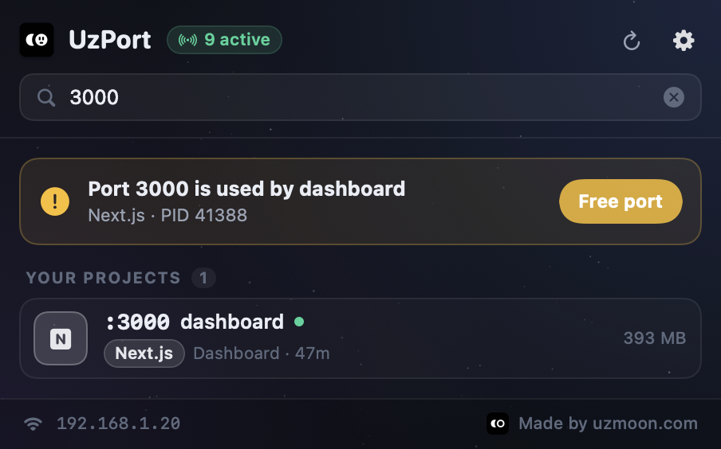
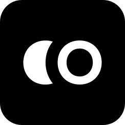

<p align="center">
  
</p>

<h1 align="center">UzPort</h1>

<p align="center">
  <b>Hangi port kimde? Menü çubuğunda, tek bakışta.</b><br>
  Mac'inde çalışan tüm geliştirme sunucularını, veritabanlarını ve Docker konteynerlerini gösterir;<br>
  tek tıkla aç, kopyala, telefonda test et ya da portu boşalt.
</p>

<p align="center">
  <a href="../../releases/latest"></a>
  
  
  
  
</p>

<p align="center"><a href="#english">English ↓</a></p>

<p align="center">
  
</p>

---

## Neden UzPort?

`Error: listen EADDRINUSE: address already in use :::3000`… Hangi terminal sekmesiydi? Hangi proje?
`lsof -i :3000` yaz, PID'yi bul, `kill -9`… UzPort bunu menü çubuğuna taşır.

- 📡 **Her şey tek panelde.** Vite, Next.js, Laravel, Django, Rails, Node, PHP… 40+ sunucu türü otomatik tanınır; proje adı `package.json`'dan ya da klasörden gelir.
- 🗂 **Akıllı gruplar.** *Projelerin*, *Veritabanları ve servisler* (PostgreSQL, Redis, MySQL, MongoDB, Ollama…), *Docker* (konteyner adı ve imajıyla), *Uygulamalar*. macOS sistem portları (AirPlay vb.) gizlidir.
- 🔎 **Port yaz, cevabı al.** Arama kutusuna `3000` yaz: doluysa kimin tuttuğunu görür, **tek tıkla boşaltırsın**; boşsa "boş" der.
- 🌐 **Sayfayı tanı.** Her sunucunun sayfa başlığı, favicon'u ve HTTP durumu (🟢 🟡 🔴), ne zamandır çalıştığı ve bellek kullanımı.
- 📱 **Telefonda test.** Ağ adresi için QR kod. Sunucu yalnızca `localhost`'u dinliyorsa uyarır (`--host` ipucuyla).
- ⚡ **Tek tık eylemler.** Tarayıcıda aç, adresi kopyala, Finder'da göster, VS Code / Cursor / Zed'de, Warp / iTerm / Terminal'de aç, PID'yi ya da komutu kopyala, süreci kapat (yanlışlıkla olmasın diye iki tık).
- 🔔 **Bildirim.** Yeni bir geliştirme sunucusu başlayınca haber verir; bildirime tıkla, açılsın.
- 🪶 **Hafif.** `lsof` çalıştırmaz; portları doğrudan macOS çekirdeğinden (`libproc`) okur. Yönetici izni istemez, Dock'ta yer kaplamaz.

<table>
  <tr>
    <td></td>
    <td align="center"></td>
  </tr>
  <tr>
    <td align="center"><sub>“3000 kimde?” — tek tıkla boşalt</sub></td>
    <td align="center"><sub>Telefonda aç</sub></td>
  </tr>
</table>

## Kurulum

1. [Son sürümden](../../releases/latest) `UzPort-x.y.z.dmg` dosyasını indir, **UzPort**'u **Applications**'a sürükle.
2. Uygulama Apple'a ücretli olarak imzalatılmadığı için ilk açılışta: Uygulamalar'da **sağ tık → Aç → Aç**
   (macOS 15+: *Sistem Ayarları → Gizlilik ve Güvenlik → Yine de Aç*) ya da:
   ```sh
   xattr -dr com.apple.quarantine /Applications/UzPort.app
   ```
3. Menü çubuğundaki 📡 simgesine tıkla. ⚙️ menüsünden **Girişte başlat**'ı açabilirsin.

## Nasıl çalışır?

- `proc_listpids` → her süreç için `PROC_PIDLISTFDS` → `PROC_PIDFDSOCKETINFO` ile **LISTEN** durumundaki TCP soketleri; 2 saniyede bir.
- Komut satırı (`KERN_PROCARGS2`) ve çalışma klasörü (`PROC_PIDVNODEPATHINFO`) ile sunucu türü ve proje kökü bulunur.
- Docker portları `docker ps` ile konteyner adlarına eşlenir (Docker Desktop, Colima, OrbStack).
- Sayfa başlığı ve favicon için sunucuya kısa bir `GET /` isteği atılır (yalnızca `localhost`).
- Yalnızca kendi kullanıcının süreçleri kapatılabilir; sistem süreçlerine dokunulmaz.

## Kaynaktan derleme

```sh
git clone https://github.com/ahmeterdgn/uzport && cd uzport
swift test                     # 9 birim testi (gerçek soket açma/kapama dahil)
./scripts/build-app.sh         # build/UzPort.app (evrensel)
VERSION=1.0.0 ./scripts/make-dmg.sh
```

Gereksinim: Xcode 15+ / Swift 5.9+, macOS 13+.

Kardeş uygulama: [**UzDisc**](https://github.com/ahmeterdgn/uzdisc) — Mac'in açamadığı diskleri salt okunur aç, dosyalarını kurtar.

---

<a name="english"></a>

## English

<p align="center">
  
</p>

**Who's on port 3000? UzPort answers from your menu bar.** It shows every dev server, database and Docker container
running on your Mac — open, copy, test on your phone, or free the port in one click.

- 📡 **Everything in one panel.** Vite, Next.js, Laravel, Django, Rails, Node, PHP… 40+ server types detected automatically, with the project name from `package.json` or the folder.
- 🗂 **Smart groups.** *Your projects*, *Databases & services*, *Docker* (with container name and image), *Apps*. macOS system ports are hidden.
- 🔎 **Type a port, get the answer.** Type `3000`: see who's using it and **free it in one click** — or confirm it's free.
- 🌐 **Know the page.** Page title, favicon, HTTP status, uptime and memory for every server.
- 📱 **Test on your phone.** QR code for the network URL, with a warning if the server only listens on `localhost`.
- ⚡ **One-click actions.** Open in browser, copy URL, reveal in Finder, open in VS Code / Cursor / Zed or Warp / iTerm / Terminal, stop the process (two clicks, to be safe).
- 🔔 **Notifications** when a new dev server starts.
- 🪶 **Lightweight.** No `lsof`, no admin password, no Dock icon — ports come straight from the kernel via `libproc`.

<table>
  <tr>
    <td></td>
    <td align="center"></td>
  </tr>
</table>

### Install

Download `UzPort-x.y.z.dmg` from the [latest release](../../releases/latest), drag **UzPort** to **Applications**.
The app isn't notarized, so on first launch **right-click → Open → Open** (or `xattr -dr com.apple.quarantine /Applications/UzPort.app`).
The UI follows your system language (Turkish/English) and can be switched in ⚙️.

---

<p align="center">
  <a href="https://uzmoon.com"></a><br>
  <sub><a href="https://uzmoon.com">uzmoon.com</a> tarafından yapılmıştır · Made by <a href="https://uzmoon.com">uzmoon.com</a></sub><br>
  <sub>MIT Lisansı</sub>
</p>
